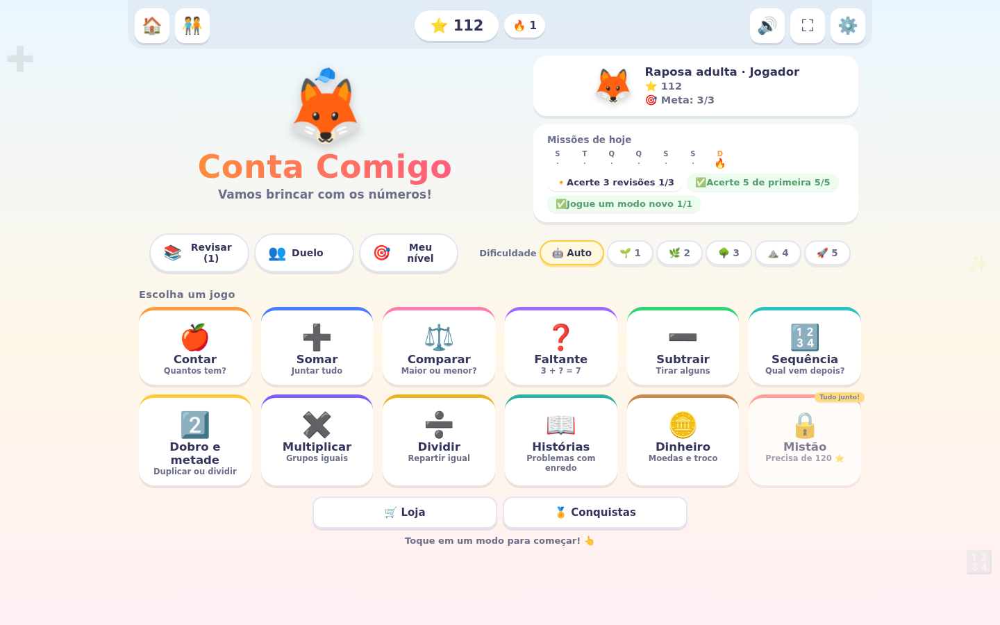
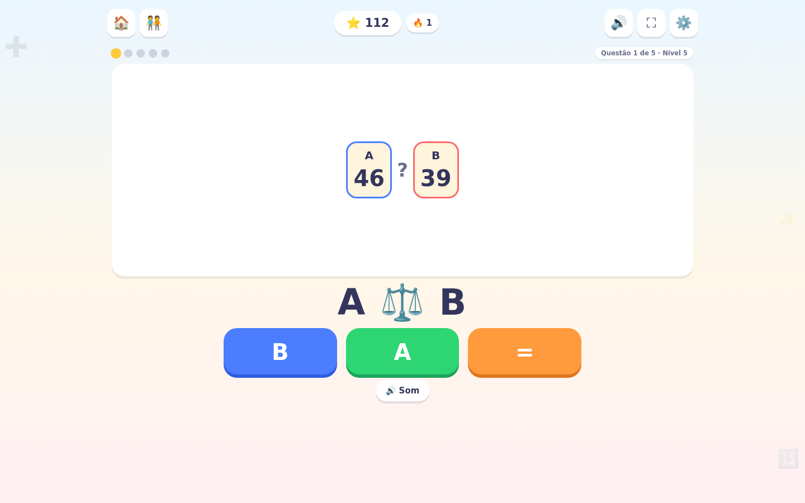
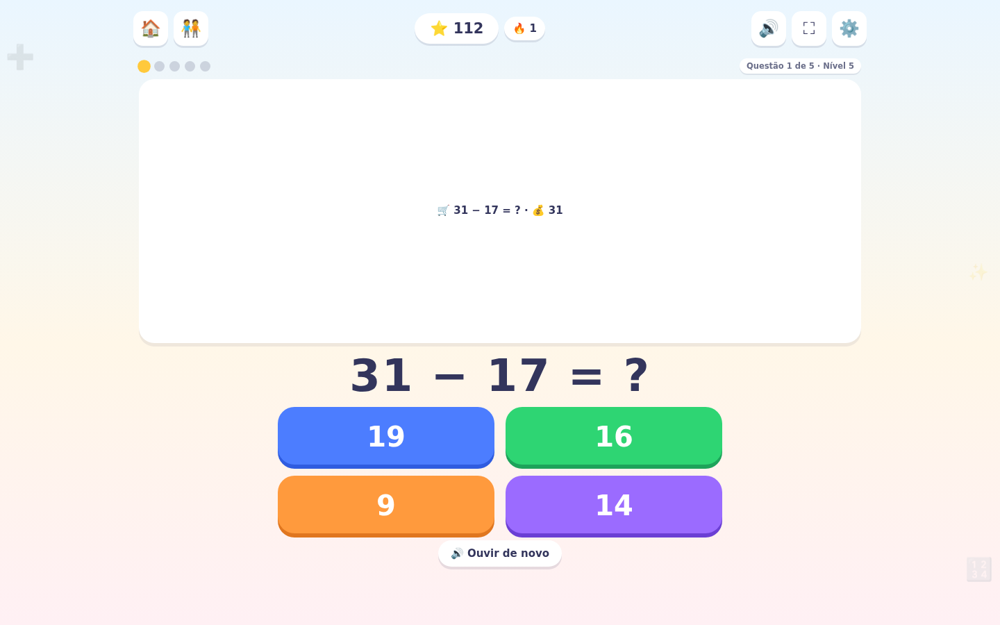
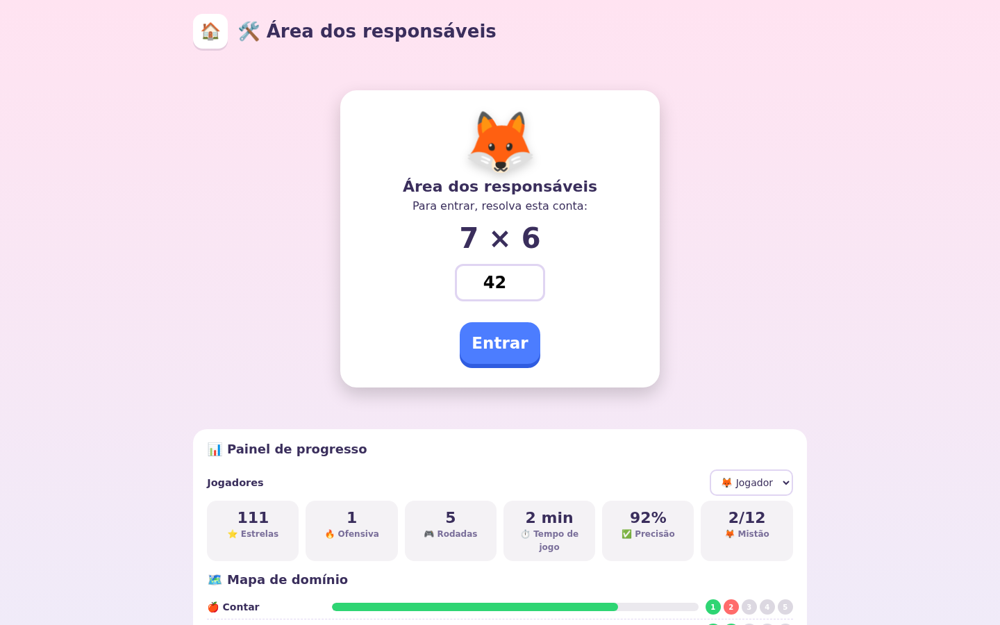

<div align="center">

# 🧮 Conta Comigo

### Matemática lúdica para crianças a partir de 4 anos


| | |
|---|---|
|  |  |
| **Dinheiro e troco** | **Painel dos responsáveis** |
|  |  |

**Desenvolvido por Klivfy Tecnologia** · trilíngue (PT/EN/ES) · funciona sem internet · sem coleta de dados

</div>

---

## ✨ O que é

O **Conta Comigo** é um jogo educativo que ensina os primeiros conceitos de matemática — contagem, comparação de quantidades, dinheiro e resolução de problemas — por meio de desafios curtos, voz amigável e recompensas colecionáveis. Cada criança tem o próprio perfil, com nome, mascote e preferências de voz, e os responsáveis acompanham tudo em um painel protegido por verificação adulta. Todo o conteúdo roda localmente no dispositivo: o jogo funciona 100% offline e não coleta nenhum dado pessoal.

## 🎮 Modos de jogo

- **Contar** — desafios de contagem com correção animada e voz
- **Comparar** — mais/menos, maior/menor e quantidades
- **Dinheiro** — pagamento e troco com cédulas e moedas
- **Histórias** — problemas contextualizados em mini-narrativas
- **Contra o Tempo** — 60 segundos de fôlego, com recorde por perfil (v2.5.0)

## 🏆 Recompensas e progresso

- ⭐ Estrelas e **ofensiva diária** com baús de recompensa em 3/7/14/21/30 dias
- 🃏 **Álbum com 36 figurinhas** para colecionar
- 🏅 **20 conquistas**, incluindo 2 secretas
- 🛍️ **Loja** com mascotes adultas (raposa, panda, dino, unicórnio e robô), temas (Oceano, Doces, Neve…) e acessórios
- 👧👦 **Perfis familiares**: o jogo chama cada criança pelo nome e guarda voz, velocidade e tonalidade preferidas de cada perfil
- 💾 **Backup de um clique** na tela de Conquistas e no painel dos responsáveis

## 🗣️ Vozes humanizadas

A narração usa a síntese de voz do próprio sistema com **seleção inteligente de qualidade**: as vozes são agrupadas de 🌟 naturais → ⚡ neurais/rede → padrão → básicas, priorizando as mais humanas disponíveis (ex.: *"Online (Natural)"* do Edge, *Premium/Enhanced* da Apple, Google de rede) e afastando motores robóticos. As opções mostram a **nota "Voz ativa"**, permitem velocidade e tonalidade por perfil e há **guia gratuito** para instalar vozes melhores em cada plataforma (Edge, Windows, Android, iPhone/Mac e Linux/Piper) — tudo em PT, EN e ES.

## 📥 Downloads diretos — v2.7.4

| Plataforma | Pacote |
|---|---|
| 🟢 Chrome / Edge / Brave | [conta-comigo-chrome-2.7.4.zip](download/conta-comigo-chrome-2.7.4.zip) |
| 🦊 Firefox (128+) | [conta-comigo-firefox-2.7.4.zip](download/conta-comigo-firefox-2.7.4.zip) |
| 🌐 Web / PWA (computador e iPhone) | [conta-comigo-pwa-2.7.4.zip](download/conta-comigo-pwa-2.7.4.zip) |
| 🤖 Android (app local da Play Store, sem PWA) | AAB gerado pelo CI: *Actions → Android (Capacitor)*; assinatura em [native/android/keystore/README.md](native/android/keystore/README.md) |
| 🎬 Vídeo promocional (2:19, pt-BR) | [conta-comigo-video-promocional-pt-BR.mp4](download/conta-comigo/loja/video/conta-comigo-video-promocional-pt-BR.mp4) + [legenda](download/conta-comigo/loja/video/conta-comigo-video-promocional-pt-BR.srt) |

> Os pacotes ficam na pasta [`download/`](download/) e são gerados a partir de `download/conta-comigo/`. Versões anteriores: [releases](https://github.com/klivfy/Conta-Comigo/releases).

## 📦 Instalação

**Chrome / Edge / Brave**
1. Baixe `conta-comigo-chrome-2.7.4.zip` (tabela acima) e descompacte
2. Abra `chrome://extensions`, ative o **modo do desenvolvedor**
3. Clique em **Carregar sem compactação** e escolha a pasta descompactada

**Firefox**
1. Baixe `conta-comigo-firefox-2.7.4.zip` e descompacte
2. Abra `about:debugging#/runtime/this-firefox` → **Carregar extensão temporária**
3. Selecione qualquer arquivo da pasta descompactada

**Android**
Instale o app da Google Play. O jogo vai dentro do pacote e roda 100% local, sem internet e sem site. A PWA não é mais oferecida no Android.

**Web / PWA (computador e iPhone)**
1. Baixe `conta-comigo-pwa-2.7.4.zip` e hospede a pasta em um endereço https
2. Abra no navegador e use **Instalar** (Chrome/Edge) ou **Adicionar à Tela de Início** (Safari)

> **Atualização sem perder progresso:** recarregar a extensão (↻ em `chrome://extensions`) preserva estrelas, conquistas e perfis; remover e reinstalar apaga — antes, exporte o backup pelo botão 💾 e reimporte depois. Para confirmar a versão: o **selo `v2.7.4`** aparece no topo do jogo, ao lado de 🔥.

## 🔐 Privacidade e público-infância

- **Zero coleta**: nenhuma conta, nenhum dado pessoal, nenhuma telemetria — tudo fica no aparelho
- **Cookies e rastreamento**: o jogo não usa nenhum; mesmo assim, um aviso discreto deixa o responsável aceitar, recusar ou personalizar, e o botão "Personalizar aceites" fica sempre no rodapé. Links de privacidade, termos e suporte passam por uma conferência para adultos
- **Portão dos responsáveis**: configurações e dados sensíveis atrás de senha guardada só no aparelho (PBKDF2-SHA-256 com sal, bloqueio progressivo); senha, sal e lembrete nunca vão para o backup nem para a sincronização
- **Conformidade**: COPPA, LGPD (com atenção especial a crianças — LGPD-K) e GDPR-K
- **Áudio local**: a narração usa a síntese de voz do próprio sistema; nada é enviado a servidores

## 🧱 Estrutura do repositório

```
download/conta-comigo/         Fonte única do jogo (extensão Chrome MV3)
download/*.zip                 Pacotes prontos das três plataformas
                               (Firefox e PWA são gerados: python scripts/build_packages.py
                                e python scripts/build_pwa.py — não são versionados)
download/conta-comigo/loja/    Materiais de publicação nas lojas (roteiros, capturas, gráficos, vídeo, política)
native/android/                App nativo Android (Capacitor — o jogo vai dentro do APK/AAB)
native/windows/                App nativo Windows 10/11 (Electron + electron-builder)
native/ios/                    App iPhone e iPad (Capacitor)
.github/workflows/             CI: Pages, APK/AAB e instalador Windows
tests/                         Testes do motor (node --test tests/*.test.cjs)
scripts/                       Build, empacotamento e verificações (i18n, sincronia, CSP, acessibilidade, responsividade, apps)
scripts/video/                 Gerador do vídeo promocional (Piper + Playwright + ffmpeg)
docs/                          Política de privacidade (HTML), ADRs e relatórios de revisão
```

Tecnologia: **JavaScript vanilla**, Web Extensions **Manifest V3**, **PWA** com service worker e **Web Speech API** — sem frameworks, sem dependências externas, sem telemetria.

## 🚀 Versões nativas (Android, Windows 10/11 e iOS)

A partir da v2.6.0 o repositório gera **pacotes nativos por CI** (GitHub Actions), sem reescrever o jogo:

- **Android (Capacitor)** — `native/android/`: APK para sideload + AAB para a Play Console, com o jogo dentro do pacote (funciona sem internet desde a primeira abertura e não depende do site); assinados com a upload key quando os secrets existem;
- **Windows (Electron)** — `native/windows/`: instalador NSIS + versão portable (x64);
- **iPhone e iPad (Capacitor)** — `native/ios/`: build de teste no CI, sem assinatura até existir a conta Apple;
- **Site (GitHub Pages)** — a mesma PWA publicada em `https://klivfy.github.io/Conta-Comigo/`, com a política de privacidade.

Os pacotes aparecem como **artefatos na aba Actions** a cada push nos diretórios correspondentes (ou executando o workflow manualmente). Detalhes: [native/README.md](native/README.md) · Estudo de viabilidade: [Release v2.6.0](https://github.com/klivfy/Conta-Comigo/releases/tag/v2.6.0).

## 🗺️ Histórico de versões

| Versão | Destaques |
|---|---|
| **2.7.4** | Tipografia e composição: piso de texto de 12 a 13 px (escala sem tamanhos duplicados), objetos do palco crescem em telas grandes, botão 🏠 repetido sai da loja e das conquistas, selo de versão sai da barra da criança |
| **2.7.3** | Movimento mais gentil: curvas próprias em todas as transições, som do toque no mesmo instante em que o botão afunda, diálogos entram sem quicar, modo calmo mantém o afundar do botão, mascote quica 3 vezes e para, barra de tempo sem recálculo de layout e saída do aviso mais rápida que a entrada |
| **2.7.2** | Cronômetro de tom único e desligado por padrão em perfis novos; loja mostra o caminho (quanto falta) em vez de recusar, com "Comprado! Desfazer" por 5 s; conquistas trancadas legíveis; o aviso de cookies saiu da tela da criança e fica no painel dos responsáveis |
| **2.7.1** | Nova aba não trava mais e conta a ofensiva; histórias e dicas em en/es com o nome certo dos objetos; nome padrão no idioma do jogo; avisos fora da rodada; conferência de adulto antes de criar a senha |
| **2.7.0** | Efeitos sonoros e voz mais naturais; Privacidade, Termos de Uso e Suporte no rodapé, com conferência para adultos; aviso de cookies (aceitar, recusar, personalizar); PWA deixa de ser oferecida no Android (app local) |
| **2.6.4** | Progresso não se perde mais entre o jogo, o painel e a nova aba; sincronização por perfil com status no painel; leitor de tela sem a resposta no Contar, contagem pelo teclado e contadores com nome; moeda do modo Dinheiro e voz do espanhol pela região; escala de espaço e fonte do CSS em uso |
| **2.6.3** | Pacote das 5 lojas em pt, en e es (117 capturas, gráficos, política trilíngue e vídeo promocional); identificador único `com.klivfy.conta.comigo.matematica`; **app Android com o jogo dentro do pacote** (Capacitor 8, API 36), backup pela folha de compartilhar, botão Voltar e nome traduzido; contagem por toque no idioma do jogo; limpeza do repositório |
| **2.6.2** | Auditoria: backup importado validado, senha com PBKDF2 e segredos fora do backup e do sync; texto acompanha o tamanho do sistema (rem, Dynamic Type) e contraste revisto; Electron 44 e Dependabot; regras do jogo no motor, com testes |
| **2.6.1** | Português do Brasil como padrão e idioma pelo navegador; pacote do Firefox Add-ons (128 ESR) e MSIX da Microsoft Store; correções de layout (Galaxy Fold, inglês) |
| **2.6.0** | Responsividade total (320px–1920px+), modo paisagem, toque aprimorado, vozes humanizadas (Fase 2), PWA Android |
| **2.5.0** | Contra o Tempo, baús de ofensiva, 5 mascotes adultas, 3 temas novos, álbum com 36 figurinhas, 20 conquistas, backup de um clique |
| **2.4.1** | Selo de versão visível no jogo |
| **2.4.0** | Voz com o nome da criança, ritmo e tonalidade por perfil, narração/efeitos separados |

## 📄 Licença

**Software proprietário.** Copyright © 2026 **Klivfy Tecnologia** — Todos os direitos reservados.

O código-fonte, a arte, os personagens e a marca **Conta Comigo** pertencem à Klivfy Tecnologia. A cópia, modificação, distribuição ou uso comercial sem autorização prévia por escrito são proibidos. Uso pessoal e familiar das versões oficiais é permitido. Consulte o arquivo [LICENSE](LICENSE) para os termos completos.
